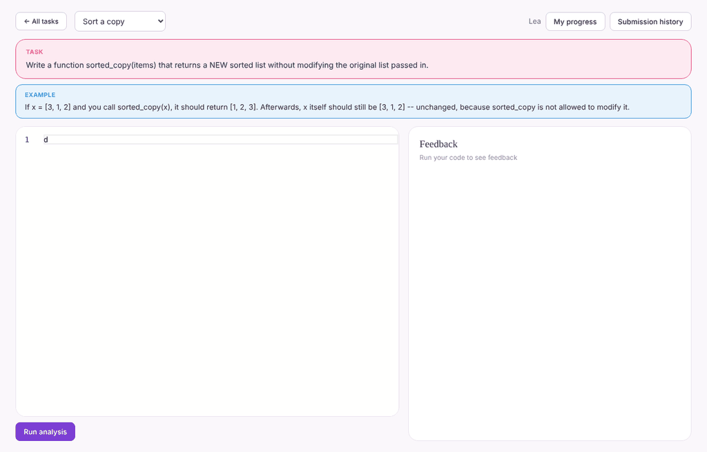
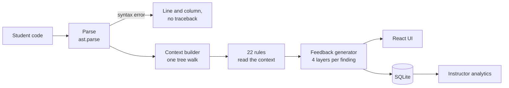
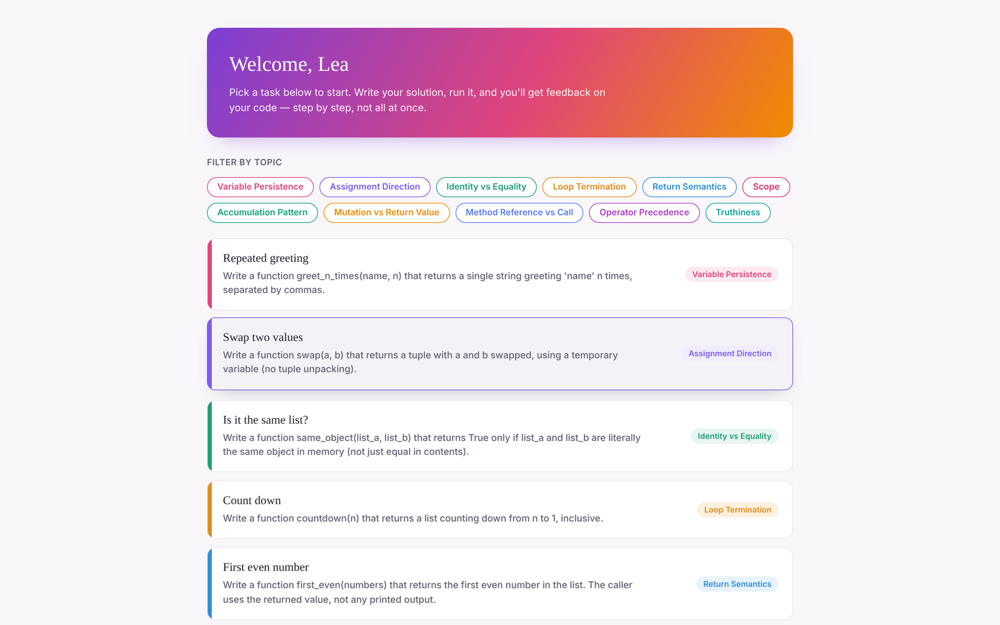
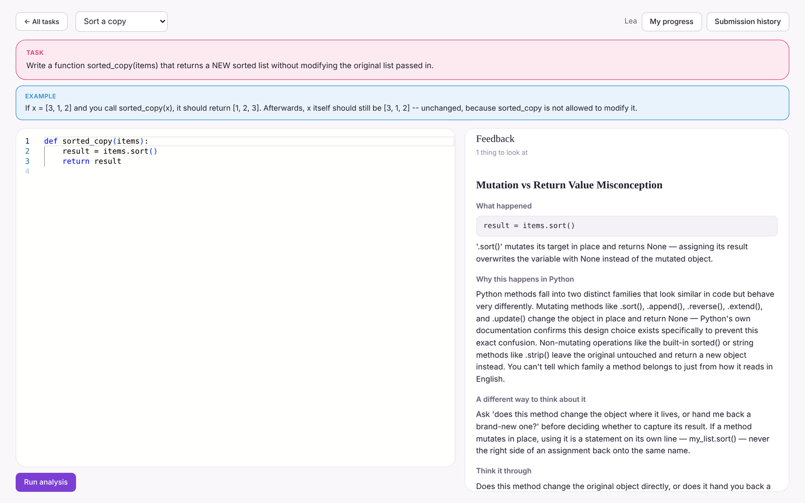
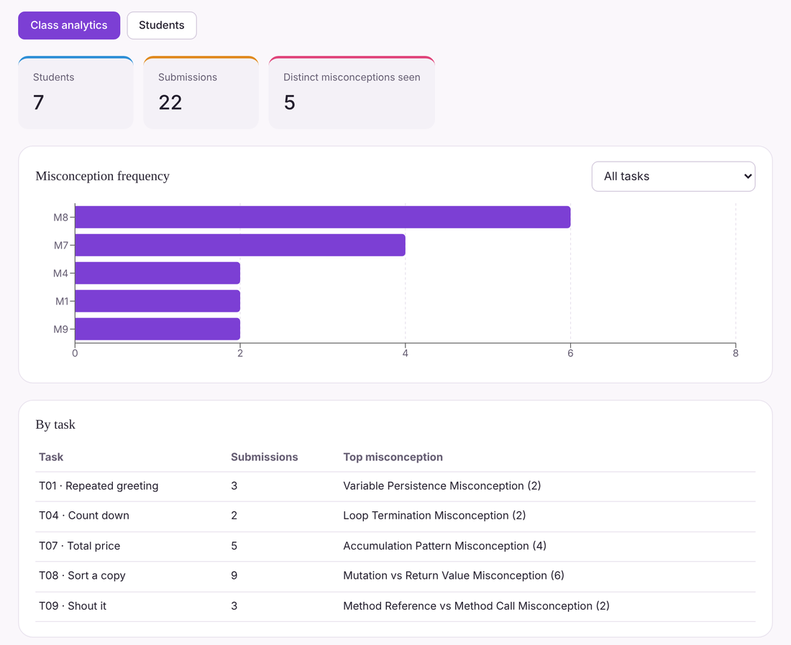

# Python Mental Model Linter

A linter for how beginners *think* about Python. It finds the wrong belief behind a mistake, not just the broken line, and explains it step by step.

Built for my Bachelor thesis at TU Darmstadt: *Identification and Reduction of Misconceptions in Programming Novices through Automated Code Analysis and Feedback-Based Support* (2026).


<p align="center">
  
</p>

## The problem

A student writes this:

```python
def sorted_copy(items):
    result = items.sort()
    return result
```

The function returns `None`. A test fails, the student changes something, the test passes, and they move on. The belief that caused the bug, that `.sort()` hands back a sorted list, is still there. Two weeks later it produces a different bug in a different exercise.

Most automated feedback tools report *that* code is wrong. A systematic review of 101 such tools found that very few explain *why* in a way a beginner can act on. Tools that run the code and compare outputs also miss mistakes that happen to pass the tests.

This project looks at the code instead of its output. It detects eleven well-documented beginner misconceptions directly in the structure of the code, and answers each one with feedback aimed at the mental model behind it.

## What it does

- **Detects misconceptions statically.** Code is parsed into an abstract syntax tree and never executed, so the same submission always gets the same feedback and untrusted code can't do any harm.
- **Explains in four layers.** Each finding opens one layer at a time: what the code does, how Python actually works here, how the student's model differs, and a question to think about. It never shows the corrected code.
- **Shows instructors the pattern.** A dashboard aggregates findings across a class, counted both by occurrences and by distinct students, so one student's repeated mistake doesn't look like a class-wide trend.
- **No machine learning in the core.** Every detection rule is plain, readable Python. When a rule fires, you can point to exactly why.

## How it works



The interesting design problem was the rules. Some only need one AST node: a bare `cart.sort` without parentheses. Others need facts spread across a whole function: a variable assigned *before* a loop, overwritten *inside* it and used *after* it.

Instead of walking the tree once per rule, the engine walks it **once** and records structured notes in a shared `SubmissionContext`: scopes, loops, functions, every assignment and read. Each rule is then a small class that only asks questions of those notes (Visitor pattern for the walk, Strategy pattern for the rules). Adding a rule means writing one class and registering it; nothing else changes.

## The four feedback layers

| Layer | In the interface | Purpose |
|---|---|---|
| 1. Observation | *What happened* | What this specific code does, neutral and without judgement |
| 2. Conceptual explanation | *Why this happens in Python* | How the language actually behaves in this situation |
| 3. Mental model correction | *A different way to think about it* | The likely wrong belief, and how the correct model differs |
| 4. Reflection prompt | *Think it through* | A guiding question, so the student works out the fix |

The structure follows Narciss's framework for informative tutoring feedback and Sorva's distinction between a surface error and the misconception behind it.

## Detected misconceptions

| ID | Misconception | Example of the wrong belief | Rules |
|---|---|---|:---:|
| M1 | Variable persistence | A variable keeps every value it has held | 2 |
| M2 | Assignment direction | `b = a` makes an independent copy of a list | 1 |
| M3 | Comparison as assignment | `is` and `==` mean the same thing | 2 |
| M4 | Loop termination | The `while` condition is checked only once | 2 |
| M5 | Return semantics | `return` inside a loop collects every value | 3 |
| M6 | Scope | Variables are global by default | 3 |
| M7 | Accumulation pattern | A loop builds up a result on its own | 2 |
| M8 | Mutation vs. return value | `.sort()` returns the sorted list | 2 |
| M9 | Method reference vs. call | `text.upper` calls the method | 2 |
| M10 | Operator precedence | `and` and `or` are evaluated left to right | 1 |
| M11 | Truthiness | An empty list should be compared to `None` | 2 |

Each rule and its exact trigger condition is documented in its class in [`analysis_engine/rules/`](analysis_engine/rules).

## Screenshots

<table>
  <tr>
    <td width="50%"></td>
    <td width="50%"></td>
  </tr>
  <tr>
    <td align="center"><sub>Eleven exercises, one per misconception</sub></td>
    <td align="center"><sub>Editor and feedback panel with all layers open</sub></td>
  </tr>
</table>

<p align="center">
  <br>
  <sub>Instructor analytics (demo data from seven test students)</sub>
</p>

## Evaluation

- **85 automated tests**, covering parsing, context building, all 22 rules, feedback generation and the full pipeline. Every rule has at least one case it must catch and one similar-looking case it must leave alone.
- **False-positive audit.** [`fp_sweep.py`](analysis_engine/tests/fp_sweep.py) runs correct, idiomatic Python that deliberately resembles each rule's pattern. Over two rounds it found nine false positives: seven are fixed and covered by regression tests, one is reported with lower confidence, and one is a documented limit of static analysis. A rule can't know whether shared references are intentional.
- **Usability.** Thirteen people used the prototype and completed the System Usability Scale questionnaire. The mean score was 86.9, slightly above the benchmark for "excellent".

## Getting started

You need Python 3.10+ and Node.js 20+.

**Backend** (from the repository root):

```bash
python -m venv .venv
source .venv/bin/activate        # Windows: .venv\Scripts\activate
pip install -r requirements.txt
uvicorn app.main:app --reload
```

The API runs on `http://127.0.0.1:8000`, with interactive docs at `/docs`. On first start it creates `thesis_app.db` and loads the eleven tasks.

**Frontend** (in a second terminal):

```bash
cd frontend
npm install
npm run dev
```

Open `http://localhost:5173`, enter any name, and choose *Student* or *Instructor*. Everything a student submits appears in the instructor view straight away.

**Tests:**

```bash
python -m pytest                              # 85 tests
python -m analysis_engine.tests.fp_sweep      # false-positive sweep, one case per rule
```

### Optional: written progress summaries

The *My progress* view shows a short summary generated from templates. If `ANTHROPIC_API_KEY` is set and the `anthropic` package is installed, the summary is written by a language model instead, from the student's aggregated numbers only, never from their code. Detection and feedback don't use it.

## API

| Method | Endpoint | Purpose |
|---|---|---|
| `POST` | `/api/users` | Create or fetch a student or instructor |
| `GET` | `/api/tasks` | List the exercises |
| `POST` | `/api/submissions` | Analyse code and store the feedback |
| `GET` | `/api/users/{id}/submissions` | A student's submission history |
| `GET` | `/api/submissions/{id}` | One submission with its code and feedback |
| `GET` | `/api/users/{id}/progress` | A student's progress, streaks and badges |
| `GET` | `/api/instructor/analytics` | Class-wide misconception frequency |
| `GET` | `/api/instructor/students` | All students with a summary |
| `GET` | `/api/instructor/suggestions` | Suggestions on what to teach again or extend |

## Project structure

```
analysis_engine/          detection and feedback, no web dependencies
  parser.py               safe parsing with readable syntax errors
  context_builder.py      the single tree walk
  registry.py             runs all 22 rules
  rules/                  one file per misconception (m1_rules.py ... m11_rules.py)
  feedback/               four-layer templates and the card generator
  pipeline.py             analyze(code) -> feedback cards
  tests/                  unit tests and the false-positive sweep
app/                      FastAPI backend, SQLite via SQLAlchemy
  routers/                users, tasks, submissions, progress, instructor
  services/               analysis and progress logic
  seed_data.py            the eleven exercises
frontend/                 React + TypeScript + Vite, Monaco editor
docs/images/              screenshots used in this README
```

## Limitations

This is a research prototype, and the thesis discusses its limits in detail. The short version:

- Each rule detects one structural form of its misconception, not every form. For example, `if x = 5:` is a syntax error in Python, so it's reported as one rather than analysed.
- For about half of the exercises, the most likely wrong answer doesn't yet trigger the matching rule. Aligning the tasks with the rules is the next step.
- The system has not yet been used in a real course, so its precision on real student code is still unmeasured.
- Login is name-only by design; there are no passwords or accounts.

## About

Bachelor thesis by **Siwar Ben Nejma**, Department of Computer Science, TU Darmstadt, 2026. Supervised by Dr. Svana Esche.

[LinkedIn](https://www.linkedin.com/in/siwar-ben-nejma-879606403)
